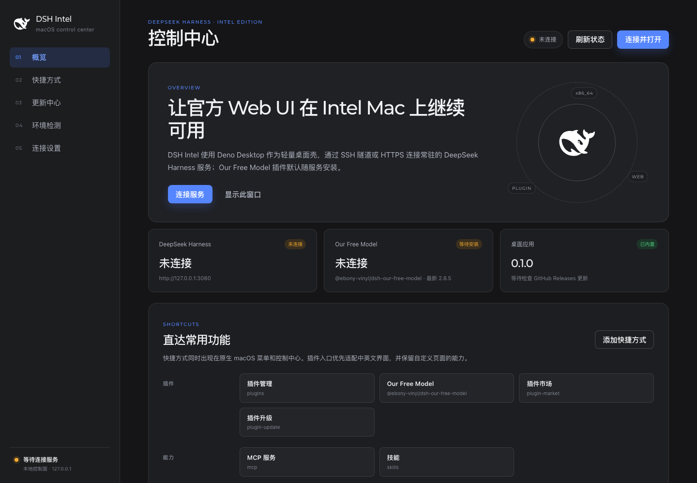
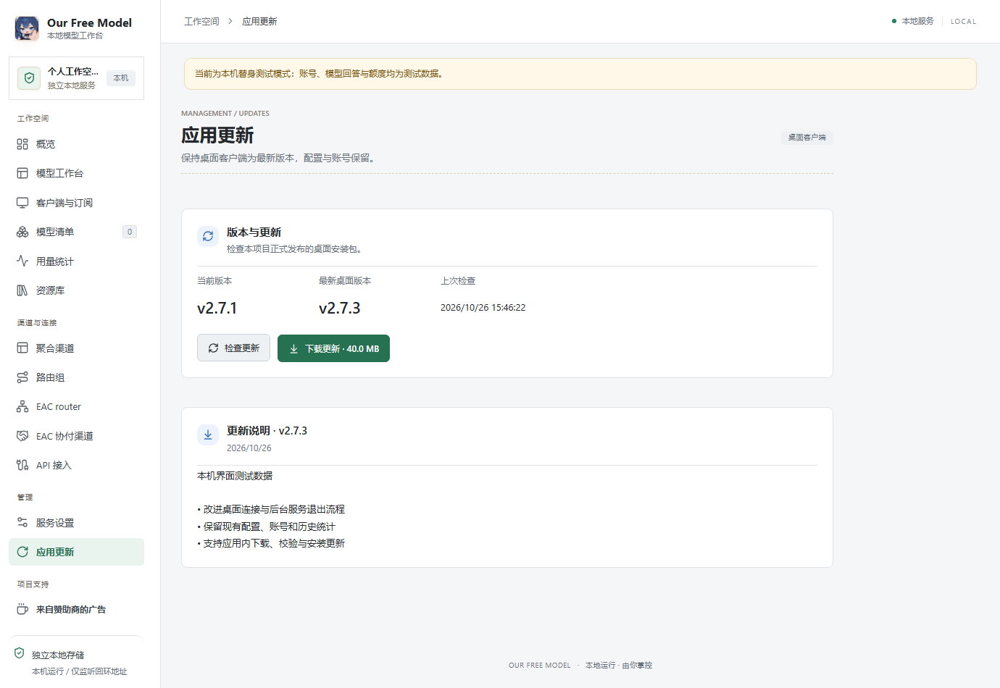

<div align="center">

# DSH Intel for macOS

**A macOS Intel desktop distribution of DeepSeek Harness**

[Download the Intel package](https://github.com/innocces/dsh-mac-intel/releases/latest) ·
[Service deployment](#deploy-the-persistent-service) · [Usage demo](#usage-demo) ·
[Update mechanism](#update-mechanism) ·
[Third-party sources and licenses](#third-party-sources-and-licenses) · [Disclaimer](#disclaimer)

[简体中文](README.md) | **English**

</div>

> [!IMPORTANT]
> DSH Intel is an **unofficial compatibility distribution** and is not affiliated with or endorsed
> by DeepSeek AI or Ebony-Vinyl. It addresses the absence of an official macOS Intel (`x86_64`)
> build of DeepSeek Harness; the Harness itself remains maintained by its upstream project.

## Screenshots

### DSH Intel control center



> This screenshot was generated from the real control-center interface in this repository using
> `deno task screenshot`. It shows the initial disconnected state; version cards use versions locked
> or queried by the project and do not contain fictional runtime statistics.

### Our Free Model update interface



> The upstream plugin screenshot comes from the
> [Our Free Model verification documentation](https://github.com/Ebony-Vinyl/dsh-our-free-model/blob/main/docs/verification/images/desktop-update-available.png)
> and is used with attribution under its MIT license.

## Usage demo

<p align="center">
  <video controls muted playsinline preload="metadata" poster="docs/screenshots/control-center.png"
    width="100%">
    <source src="docs/videos/dsh-intel-control-center.mp4" type="video/mp4" />
    Your browser does not support HTML5 video. <a href="docs/videos/dsh-intel-control-center.mp4">Download the MP4 directly</a>.
  </video>
</p>

> The video was recorded locally by `deno task e2e`, which drives real Chrome automatically. It
> covers the overview, navigation highlighting, adding and removing shortcuts, checking for updates,
> and saving settings. It contains no audio.

## Why DSH Intel is needed

The official DeepSeek Harness desktop application currently has no available macOS Intel (`x86_64`)
release, and some native DSH dependencies cannot run directly on Intel Macs. This project uses:

1. **The official web UI**: the DSH native runtime does not execute locally on an Intel Mac.
2. **Deno Desktop**: the desktop client is responsible only for the window, native menus,
   connection, and control; users do not need to install Node.js.
3. **A persistent service**: the official `dsh web` runs on an `x86_64 Linux` server that supports
   DSH.
4. **A secure tunnel**: the Mac accesses the service through a local SSH forward, with the service
   listening only on `127.0.0.1:3080` by default.

```text
┌──────────────────────── macOS Intel ────────────────────────┐
│ DSH Intel.app                                                │
│ ├─ Deno Desktop / native menus / custom control center       │
│ ├─ Local SSH forward (or an HTTPS reverse proxy)             │
│ └─ Deno.autoUpdate: differential updates for the desktop app │
└──────────────────────────────────────────────────────────────┘
                            │ SSH / HTTPS
┌───────────────────────────▼──────────────────────────────────┐
│ Persistent x86_64 Linux service                               │
│ ├─ Node.js 24.9.0 + pnpm 11.28.5 (installed in isolation)    │
│ ├─ Official @deepseek-ai/dsh web                             │
│ ├─ @ebony-vinyl/dsh-our-free-model bundled by default       │
│ └─ Version directories, health checks, rollback, dual updates│
└──────────────────────────────────────────────────────────────┘
```

## Features

- **Our Free Model bundled by default**: the service installation prefers the plugin tarball from
  the release after SHA-512 verification, so it is available as soon as Harness starts.
- **Automatic plugin updates**: reuse the plugin's own download, verification, backup, replacement,
  hot-reload, and rollback flow. Service update commands also back up the entire profile. The
  control center can enable scheduled checks and unattended updates.
- **Automatic Harness updates**: a new version is installed in a separate directory and switched
  atomically only after a health check succeeds; failures automatically restore the previous
  runtime.
- **Automatic desktop-shell updates**: the desktop app downloads a BSD differential patch from the
  GitHub Releases `latest.json` manifest and verifies its SHA-256 before applying it on the next
  launch. The Deno runtime provides rollback on failure.
- **Native shortcut menus**: entries for plugin management, Our Free Model, plugin updates, the
  plugin marketplace, MCP, skills, scheduled tasks, the terminal, and settings are available in both
  the macOS menu and the control center.
- **A custom control interface**: users can add official panels, custom interface text, or shortcuts
  to any `http(s)` URL.
- **Environment detection**: required and optional dependencies are distinguished. The lack of
  Node.js on the Mac does not prevent use of the desktop client.
- **No Node.js on the desktop**: release packages include the Deno runtime; only the remote Linux
  service requires Node.js.

## Download and installation

### 1. Install the desktop application

Download the following files from
[GitHub Releases](https://github.com/innocces/dsh-mac-intel/releases/latest):

- `DSH-Intel-macos-x86_64.zip`
- `DSH-Intel-macos-x86_64.zip.sha256`

Verify and extract the archive:

```bash
shasum -a 256 -c DSH-Intel-macos-x86_64.zip.sha256
ditto -x -k DSH-Intel-macos-x86_64.zip
mv DSH-Intel.app /Applications/
```

> Public builds currently use an ad-hoc signature and have not been notarized by Apple. macOS may
> therefore display a security warning. Verify the SHA-256 checksum, source code, and third-party
> sources in the release before opening the application. Do not bypass system security warnings when
> the source cannot be verified.

### 2. Deploy the persistent service

The `dsh-mac-intel-service.tar.gz` service package currently targets **Linux x86_64**. Run the
following on the server:

```bash
tar -xzf dsh-mac-intel-service.tar.gz
cd service
./install.sh
```

The installation script:

1. Downloads and verifies the official Linux x64 Node.js `24.9.0` archive.
2. Installs pnpm `11.28.5` in an isolated directory.
3. Installs `@deepseek-ai/dsh` and the default `@ebony-vinyl/dsh-our-free-model` plugin.
4. Creates a `systemd --user` persistent service listening on `127.0.0.1:3080`.
5. Attempts to run `loginctl enable-linger` so the service can continue after the user logs out.

Enable linger manually if the script cannot complete it because of insufficient permissions:

```bash
sudo loginctl enable-linger "$USER"
```

View status and logs:

```bash
~/.local/share/dsh-mac-intel/bin/dsh-mac-intel-service status
systemctl --user status dsh-mac-intel.service
journalctl --user -u dsh-mac-intel.service -f
```

### 3. Connect the Mac

Open DSH Intel, select **SSH tunnel (recommended)** under "Connection settings", and enter the
server, user, and SSH port. The default service path is:

```text
~/.local/share/dsh-mac-intel/bin/dsh-mac-intel-service
```

Save the settings and click "Connect to service". Direct HTTPS connections are also supported; keep
an SSH management configuration if one-click updates are required.

> The service binds to the loopback interface by default. Do not expose port `3080` directly to the
> public internet. Public access should use a reverse proxy with authentication, TLS, rate limiting,
> and access logging.

## Update mechanism

| Component               | Check location                                | Update method                                                    | Failure protection                             |
| ----------------------- | --------------------------------------------- | ---------------------------------------------------------------- | ---------------------------------------------- |
| Our Free Model plugin   | Plugin settings, npm registry, service status | Plugin hot update; service snapshots the profile before updating | Restores the previous plugin/profile version   |
| DeepSeek Harness        | npm registry, service status                  | Installs to `versions/dsh-<version>`, then switches atomically   | Restores the previous version directory        |
| DSH Intel desktop shell | GitHub Releases `latest.json`                 | Deno `autoUpdate` downloads a BSD patch and verifies its SHA-256 | The Deno runtime keeps a backup and rolls back |

The first installation still requires manually downloading the complete application. After one
version is installed, subsequent releases provide differential patches from the preceding version.

Manually update service components:

```bash
~/.local/share/dsh-mac-intel/bin/dsh-mac-intel-service update-plugin
~/.local/share/dsh-mac-intel/bin/dsh-mac-intel-service update-harness
~/.local/share/dsh-mac-intel/bin/dsh-mac-intel-service update-all
```

## Local development

Deno `2.9.7` is required. Node.js is not required on the development machine.

```bash
# Check and test
deno task check

# Development mode
deno task dev

# Generate a real control-center screenshot
deno task screenshot

# Run the complete E2E suite in real Chrome and update the screenshot and demo video
deno task e2e

# Build the macOS Intel application
deno task build:macos:x86_64

# Generate the application archive and service package
deno task package:macos:x86_64
deno task prepare:plugin
deno task package:service
```

GitHub Actions runs checks on the `main` branch and builds, generates update patches, and publishes
a GitHub release for `v*` tags. See [`.github/workflows`](.github/workflows) for details.

## Project structure

```text
main.ts                       Deno Desktop entry point
src/                          Desktop app: configuration, SSH, control center, updates, and menus
src/ui/                       Custom control center (HTML/CSS/JS)
service/                      Linux x86_64 persistent-service installation and update scripts
assets/                       DSH/OFM marks, fonts, artwork, and the macOS icon
scripts/                      Build, plugin verification, preview, screenshot, and browser E2E scripts
tests/                        Configuration, security-boundary, version, and service-status tests
docs/screenshots/             Real screenshots used by the README
docs/videos/                  Real usage demo video used by the README
```

## Third-party sources and licenses

The project's main functionality comes from the following open-source projects. See
[`THIRD_PARTY_NOTICES.md`](THIRD_PARTY_NOTICES.md) for the full source-level notices.

| Project                     | Purpose                                                       | Source                                            | License                        |
| --------------------------- | ------------------------------------------------------------- | ------------------------------------------------- | ------------------------------ |
| DeepSeek Harness            | Official Harness, web UI, and plugin management               | https://github.com/deepseek-ai/deepseek-harness   | MIT                            |
| Our Free Model              | Default bundled plugin and model/channel registry             | https://github.com/Ebony-Vinyl/dsh-our-free-model | MIT                            |
| Deno Runtime / Desktop      | Node.js-free desktop runtime and build tooling                | https://github.com/denoland/deno                  | MIT                            |
| Laufey                      | Deno Desktop window, menus, and CEF backend                   | https://github.com/littledivy/laufey              | Apache-2.0                     |
| Chromium Embedded Framework | Renderer used by Laufey                                       | https://github.com/chromiumembedded/cef           | BSD-style and upstream notices |
| Node.js                     | Runtime used only by the remote Linux service                 | https://github.com/nodejs/node                    | MIT                            |
| pnpm                        | DSH profile and plugin package management                     | https://github.com/pnpm/pnpm                      | MIT                            |
| Montserrat                  | Control-center brand typeface                                 | https://fonts.google.com/specimen/Montserrat      | SIL OFL 1.1                    |
| models.dev                  | Model metadata used by the plugin                             | https://github.com/anomalyco/models.dev           | MIT                            |
| Magpie                      | Optional local routing engine used by the plugin              | https://github.com/yetone/magpie                  | MIT                            |
| DeepSeek whale-girl artwork | Application icon, control-center brand image, icon adaptation | https://github.com/Small-tailqwq/dsh-deep-whale   | CC BY-NC-SA 4.0                |

The project's own code is licensed under the [MIT License](LICENSE). Third-party components remain
subject to their respective licenses and notices; the plugin package includes complete notices for
channel-pack, Magpie, and Go dependencies.

> [!IMPORTANT]
> The whale-girl artwork and adapted icon are licensed under **CC BY-NC-SA 4.0**. They are limited
> to non-commercial use and require the attribution chain to be retained and adaptations to be
> shared under the same terms. The MIT license applies only to project code, not to
> `assets/DSH-Intel-whale-girl.png`, `assets/DSH-Intel-icon.svg`, or `assets/DSH-Intel.icns`.
> Commercial distribution must obtain separate permission or replace these artwork assets. See
> [`THIRD_PARTY_NOTICES.md`](THIRD_PARTY_NOTICES.md) and
> [`assets/LICENSE-ARTWORK`](assets/LICENSE-ARTWORK) for the complete attribution chain,
> modification notices, and license.

## Disclaimer

1. **Unofficial project**: DSH Intel is not an official product of DeepSeek AI or Ebony-Vinyl, is
   not affiliated with, sponsored by, or endorsed by them, and cannot change their service policies.
2. **Third-party models and channels**: information about "free" models, free quotas, OAuth, API
   keys, and local models supplied by Our Free Model comes from third parties. Availability, quotas,
   model names, supported regions, and terms may change at any time. This project does not control
   or guarantee those services.
3. **Accounts and credentials**: account sign-in, tokens, API keys, and channel credentials are
   handled by their respective service providers. Use separate accounts, follow service terms, and
   do not store sensitive credentials on untrusted computers or servers.
4. **Privacy and data flows**: prompts, attachments, code, or tool context may be sent to the
   relevant provider when third-party models are used. Review each provider's data policy before
   deployment; DSH Intel does not create an additional independent model proxy service.
5. **Costs and loss**: third-party channels may charge fees or impose rate limits, bans, and
   outages. Assess the costs and risks before installing, signing in, upgrading, or using them.
6. **Security boundaries**: this project listens on loopback by default and uses SSH tunnels.
   Responsibility for exposing the service publicly, configuring a reverse proxy, storing private
   keys, or enabling unattended updates rests with the user.
7. **Software status**: the current version has not been notarized by Apple, and the desktop shell's
   default update manifest uses HTTPS plus SHA-256 integrity verification without mandatory Ed25519
   manifest signatures. Verify release checksums and source code before enabling unattended updates.
8. **No warranty**: the software is provided "as is", without warranties of absolute security,
   availability, compatibility, or freedom from errors. Changes in upstream functionality, npm
   packages, model APIs, and system policies may cause updates to fail.
9. **Compliance responsibility**: comply with applicable laws and regulations in your jurisdiction
   regarding software licensing, model use, cross-border data transfers, account sharing, automatic
   subscriptions, and third-party service access.
