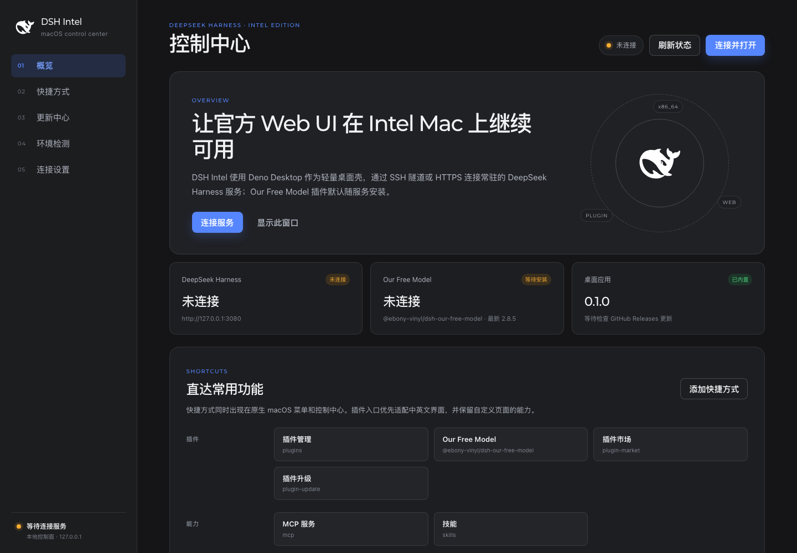
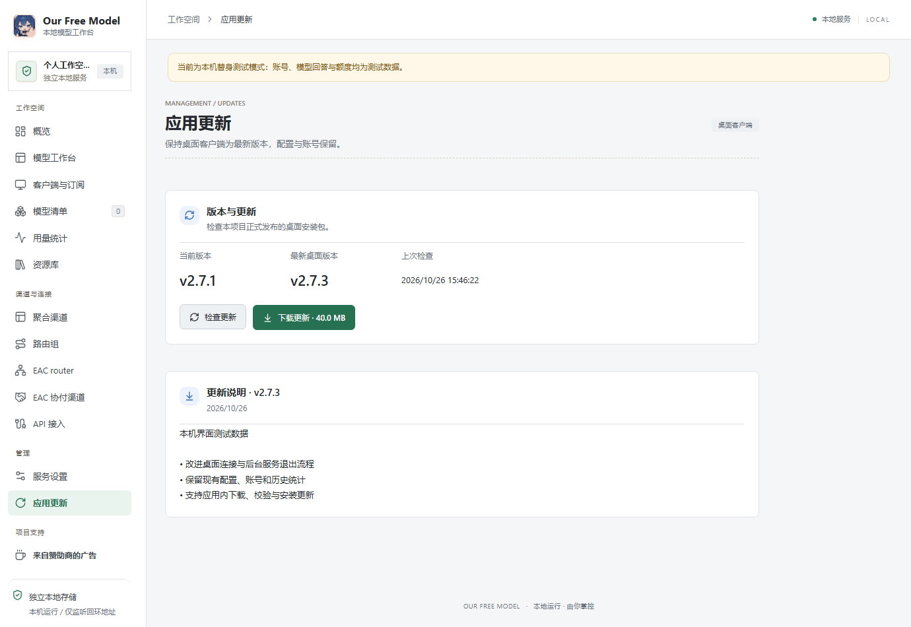

<div align="center">

# DSH Intel for macOS

**DeepSeek Harness 的 macOS Intel 桌面发行版**

[下载 Intel 安装包](https://github.com/innocces/dsh-mac-intel/releases/latest) ·
[服务部署](#部署常驻服务) · [使用演示](#使用演示) · [更新机制](#更新机制) ·
[第三方来源与许可证](#第三方来源与许可证) · [免责声明](#免责声明)

[简体中文](README.md) | [English](README.en.md)

</div>

> [!IMPORTANT]
> DSH Intel 是**非官方兼容发行项目**，与 DeepSeek AI、Ebony-Vinyl 无隶属或背书关系。它解决的是官方
> DeepSeek Harness 桌面发行物未覆盖 macOS Intel 的问题；DeepSeek Harness 本体仍由上游项目维护。

## 应用截图

### DSH Intel 控制中心



> 截图由本仓库的真实控制中心界面通过 `deno task screenshot`
> 生成，展示未连接服务时的初始状态；版本卡片使用项目锁定/查询到的版本，不包含虚构的运行统计。

### Our Free Model 自带更新界面



> 上游插件截图来自
> [Our Free Model 的验证文档](https://github.com/Ebony-Vinyl/dsh-our-free-model/blob/main/docs/verification/images/desktop-update-available.png)，按其
> MIT 许可证署名使用。

## 使用演示

<p align="center">
  <video controls muted playsinline preload="metadata" poster="docs/screenshots/control-center.png"
    width="100%">
    <source src="docs/videos/dsh-intel-control-center.mp4" type="video/mp4" />
    你的浏览器不支持 HTML5 视频，请<a href="docs/videos/dsh-intel-control-center.mp4">直接下载 MP4</a>。
  </video>
</p>

> 视频由本机 `deno task e2e` 使用真实 Chrome 自动操作并录制，覆盖概览、步骤导航高亮、
> 快捷方式增删、检查更新和保存设置；不包含音频。

## 为什么需要 DSH Intel

官方 DeepSeek Harness 的桌面应用当前没有可用的 macOS Intel（`x86_64`）发行包，而 DSH
的部分原生依赖也无法在 Intel Mac 上直接运行。本项目采用：

1. **官方 Web UI**：不在 Intel Mac 本地执行 DSH 原生运行时；
2. **Deno Desktop**：桌面端只负责窗口、原生菜单、连接与控制，不要求用户安装 Node.js；
3. **常驻服务**：在支持 DSH 的 `x86_64 Linux` 服务器上运行官方 `dsh web`；
4. **安全隧道**：Mac 通过 SSH 本地转发访问服务，服务默认只监听 `127.0.0.1:3080`。

```text
┌──────────────────────── macOS Intel ────────────────────────┐
│ DSH Intel.app                                                │
│ ├─ Deno Desktop / 原生菜单 / 自定义控制中心                   │
│ ├─ SSH 本地转发（或 HTTPS 反向代理）                         │
│ └─ Deno.autoUpdate：桌面壳差分更新                            │
└───────────────────────────┬──────────────────────────────────┘
                            │ SSH / HTTPS
┌───────────────────────────▼──────────────────────────────────┐
│ Linux x86_64 常驻服务                                         │
│ ├─ Node.js 24.9.0 + pnpm 11.28.5（隔离目录安装）              │
│ ├─ 官方 @deepseek-ai/dsh web                                 │
│ ├─ 默认内置 @ebony-vinyl/dsh-our-free-model                  │
│ └─ 版本目录、健康检查、失败回滚、双组件更新                    │
└──────────────────────────────────────────────────────────────┘
```

## 功能

- **默认内置 Our Free Model**：服务安装时优先使用 Release 中经过 SHA-512 校验的插件
  tarball；首次进入 Harness 即可使用。
- **插件自动更新**：复用插件自身“下载 → 校验 → 备份 → 替换 → 热重载 →
  失败回滚”流程；服务更新命令还会备份整个 profile。控制中心可开启定期检查和无人值守更新。
- **Harness 自动更新**：新版本先安装到独立目录，健康检查通过后再原子切换；失败自动恢复旧运行时。
- **桌面壳自动更新**：从 GitHub Releases 的 `latest.json` 获取 BSD 差分补丁，校验 SHA-256
  后在下次启动生效，失败由 Deno 运行时回滚。
- **原生快捷菜单**：插件管理、Our Free
  Model、插件升级、插件市场、MCP、技能、定时任务、终端和设置等入口同时进入 macOS 菜单与控制中心。
- **自定义控制界面**：可增加官方面板、界面文字或任意 `http(s)` URL 快捷方式。
- **单窗口工作区**：控制中心与 DeepSeek Harness 在同一个应用窗口内切换，不再额外打开浏览器窗口；
  可通过原生菜单“显示控制中心”随时返回。
- **环境检测**：区分必需项与可选项；Mac 端没有 Node.js 也不会阻断使用。
- **无 Node 桌面端**：发布包内含 Deno 运行时；只有远程 Linux 服务需要 Node.js。

## 下载与安装

### 1. 安装桌面应用

从 [GitHub Releases](https://github.com/innocces/dsh-mac-intel/releases/latest) 下载：

- `DSH-Intel-macos-x86_64.zip`
- `DSH-Intel-macos-x86_64.zip.sha256`

校验并解压：

```bash
shasum -a 256 -c DSH-Intel-macos-x86_64.zip.sha256
ditto -x -k DSH-Intel-macos-x86_64.zip
mv DSH-Intel.app /Applications/
```

> 当前公开构建使用临时签名（ad-hoc signature），没有 Apple Developer ID 公证。macOS
> 可能因此显示安全提示；请先核对 Release 中的
> SHA-256、源码和第三方来源，再决定是否打开。不要在无法核对来源时绕过系统安全提示。

### 2. 在本机启动常驻服务（推荐）

打开 DSH Intel 的“连接设置”，点击 **“启动并填入连接”**。应用会自动完成以下操作：

1. 下载并通过 SHA-256 校验隔离的 Node.js `24.9.0` macOS x64 运行时；
2. 安装官方 `@deepseek-ai/dsh` 和默认的 Our Free Model 插件；
3. 注册 macOS LaunchAgent `com.innocces.dsh-mac-intel.service`；
4. 仅在 `127.0.0.1:3080` 启动 DSH Web；
5. 自动把连接方式切换为 HTTP 直连，并填入 `http://127.0.0.1:3080`。

首次安装需要访问 `nodejs.org` 和 npm registry，耗时取决于网络；完整运行时约占 `1.6 GB`，安装前
还会检查目标磁盘至少有 `2 GiB` 可用空间。文件保存在
`~/Library/Application Support/DSH Intel/local-service`，LaunchAgent 日志位于同目录的
`service.log`。不再需要时可以在同一界面点击“停止本机服务”；停止不会删除已安装文件。

为避免浏览器或插件自动更新失败后不断堆积临时文件，本机服务使用独立的 `tmp` 目录，不会写入 macOS
全局临时目录。清理 LaunchAgent 每 5 分钟运行一次：删除超过 24 小时的失败更新残留，并把该目录限制在
`1 GiB` 内；正在写入的文件会保留 10 分钟保护期。清理日志位于同目录的 `cleanup.log`。

> 本机服务只监听 loopback，不会直接暴露到局域网或公网。当前受管组件的一键更新仍要求 SSH
> 配置；本机模式的安装与运行不依赖远程服务器。

### 3. 在 Linux 服务器部署常驻服务

如果需要 7×24 小时运行，也可以在远程 Linux x86_64 服务器部署。服务安装包
`dsh-mac-intel-service.tar.gz` 当前面向 **Linux x86_64**。在服务器上执行：

```bash
tar -xzf dsh-mac-intel-service.tar.gz
cd service
./install.sh
```

安装脚本会：

1. 下载并校验 Node.js `24.9.0` 的官方 Linux x64 归档；
2. 在隔离目录安装 pnpm `11.28.5`；
3. 安装 `@deepseek-ai/dsh` 和默认的 `@ebony-vinyl/dsh-our-free-model`；
4. 创建 `systemd --user` 常驻服务并监听 `127.0.0.1:3080`；
5. 尝试执行 `loginctl enable-linger`，使服务在退出登录后继续运行。

手动开启 linger（脚本因权限不足未自动完成时）：

```bash
sudo loginctl enable-linger "$USER"
```

查看状态与日志：

```bash
~/.local/share/dsh-mac-intel/bin/dsh-mac-intel-service status
systemctl --user status dsh-mac-intel.service
journalctl --user -u dsh-mac-intel.service -f
```

### 4. 连接 Mac

打开 DSH Intel，在“连接设置”中选择 **SSH 隧道（推荐）**。DeepSeek Harness 官方 Web UI
的标准监听地址是 `http://127.0.0.1:3080`，OpenSSH 默认端口是 `22`；点击 **“填入官方标准配置”**
可自动填入远端端口 `3080`、本地转发端口 `3080`、SSH 端口 `22` 和辅助脚本路径。

通常只需要补充 **服务器或 OpenSSH 主机别名**。如果 `~/.ssh/config` 已配置用户、密钥和端口，
用户与身份文件可以留空：

```sshconfig
Host dsh-server
  HostName 203.0.113.10
  User dsh
  Port 22
  IdentityFile ~/.ssh/id_ed25519
```

此时在应用中只需填写主机别名 `dsh-server`。受管服务辅助脚本的默认路径为：

```text
~/.local/share/dsh-mac-intel/bin/dsh-mac-intel-service
```

保存后点击“连接服务”。SSH 模式会把远端 `127.0.0.1:3080` 转发到本机 `127.0.0.1:3080`，无需另外填写
Web 地址。也可以选择 HTTPS 直连；一键更新需要配置 SSH 连接，并在远程服务器上安装
`dsh-mac-intel-service` 辅助程序。

> 服务默认只绑定 loopback。不要直接把 `3080`
> 暴露到公网；公网访问应使用带认证、TLS、速率限制和访问日志的反向代理。

## 更新机制

| 组件                | 检查位置                               | 更新方式                                            | 失败保护                      |
| ------------------- | -------------------------------------- | --------------------------------------------------- | ----------------------------- |
| Our Free Model 插件 | 插件设置页、npm registry、服务状态接口 | 插件自带热更新；服务执行 profile 快照后更新         | 自动恢复上一插件/profile 版本 |
| DeepSeek Harness    | npm registry、服务状态接口             | 安装到 `versions/dsh-<version>`，健康检查后原子切换 | 自动恢复旧版本目录            |
| DSH Intel 桌面壳    | GitHub Releases `latest.json`          | Deno `autoUpdate` 下载 BSD 差分并校验 SHA-256       | Deno 运行时保留备份并自动回滚 |

首次安装仍需手动下载完整应用；从一个已安装版本开始，后续 Release 会提供上一版本到新版本的差分补丁。

手动执行服务更新：

```bash
~/.local/share/dsh-mac-intel/bin/dsh-mac-intel-service update-plugin
~/.local/share/dsh-mac-intel/bin/dsh-mac-intel-service update-harness
~/.local/share/dsh-mac-intel/bin/dsh-mac-intel-service update-all
```

## 本地开发

需要 Deno `2.9.7`；不需要在开发机上安装 Node.js。

```bash
# 检查、测试
deno task check

# 开发模式
deno task dev

# 生成真实控制中心截图
deno task screenshot

# 在真实 Chrome 中执行完整 E2E，并更新截图与演示视频
deno task e2e

# 构建 macOS Intel 应用
deno task build:macos:x86_64

# 生成应用 ZIP 与服务包
deno task package:macos:x86_64
deno task prepare:plugin
deno task package:service
```

GitHub Actions 会在 `main` 分支执行检查。每次代码推送到 `main` 后，Release workflow 会自动递增
补丁版本、创建对应的 `v*` 标签，并构建、生成更新补丁和发布 GitHub Release；手动推送 `v*` 标签或
手动触发 workflow 也会发布对应版本。详见 [`.github/workflows`](.github/workflows)。

## 项目结构

```text
main.ts                       Deno Desktop 入口
src/                          桌面应用：配置、SSH、控制中心、更新与菜单
src/ui/                       自定义控制中心（HTML/CSS/JS）
service/                      Linux x86_64 常驻服务安装与更新脚本
assets/                       DSH/OFM 标志、字体与 macOS 图标
scripts/                      构建、插件校验、预览、截图与真实浏览器 E2E
tests/                        配置、安全边界、版本与服务状态测试
docs/screenshots/             README 使用的真实截图
docs/videos/                  README 使用的真实操作演示视频
```

## 第三方来源与许可证

本项目的主要功能来自以下开源项目；完整说明见 [`THIRD_PARTY_NOTICES.md`](THIRD_PARTY_NOTICES.md)。

| 项目                        | 用途                                 | 来源                                              | 许可证             |
| --------------------------- | ------------------------------------ | ------------------------------------------------- | ------------------ |
| DeepSeek Harness            | 官方 Harness、Web UI、插件管理       | https://github.com/deepseek-ai/deepseek-harness   | MIT                |
| Our Free Model              | 默认内置插件、模型/渠道注册表        | https://github.com/Ebony-Vinyl/dsh-our-free-model | MIT                |
| Deno Runtime / Desktop      | 无 Node 桌面运行时与编译工具         | https://github.com/denoland/deno                  | MIT                |
| Laufey                      | Deno Desktop 的窗口、菜单与 CEF 后端 | https://github.com/littledivy/laufey              | Apache-2.0         |
| Chromium Embedded Framework | Laufey 使用的渲染器                  | https://github.com/chromiumembedded/cef           | BSD 风格及上游声明 |
| Node.js                     | 仅远程服务运行时                     | https://github.com/nodejs/node                    | MIT                |
| pnpm                        | DSH profile 与插件包管理             | https://github.com/pnpm/pnpm                      | MIT                |
| Montserrat                  | 控制中心品牌字体                     | https://fonts.google.com/specimen/Montserrat      | SIL OFL 1.1        |
| models.dev                  | 插件使用的模型元数据                 | https://github.com/anomalyco/models.dev           | MIT                |
| Magpie                      | 插件可选本地路由引擎                 | https://github.com/yetone/magpie                  | MIT                |
| DeepSeek 鲸鱼娘美术         | 应用图标、控制中心品牌图与图标派生   | https://github.com/Small-tailqwq/dsh-deep-whale   | CC BY-NC-SA 4.0    |

本项目自身代码采用 [MIT License](LICENSE)。第三方组件仍受其各自许可证与声明约束；插件包内的
channel-pack、Magpie、Go 依赖等完整声明随插件 tarball 一并分发。

> [!IMPORTANT]
> 鲸鱼娘美术及其改编图标采用 **CC BY-NC-SA 4.0**，仅允许非商业使用，并要求保留署名链与相同方式共享。
> MIT 仅适用于项目代码，不适用于 `assets/DSH-Intel-whale-girl.png`、 `assets/DSH-Intel-icon.svg` 和
> `assets/DSH-Intel.icns`。商业发行必须另行取得授权或替换这些美术素材；
> 完整署名链、修改说明与许可证见 [`THIRD_PARTY_NOTICES.md`](THIRD_PARTY_NOTICES.md) 和
> [`assets/LICENSE-ARTWORK`](assets/LICENSE-ARTWORK)。

## 免责声明

1. **非官方声明**：DSH Intel 不是 DeepSeek AI 或 Ebony-Vinyl
   的官方产品，不隶属于、不赞助、不背书这些项目，也无权修改其服务政策。
2. **第三方模型与渠道**：Our Free Model 聚合的“免费”、免费额度、OAuth、API Key
   和本地模型信息来自第三方。免费状态、配额、模型名称、可用地区和条款可能随时变化；本项目不控制也不保证这些服务。
3. **账号与凭据**：插件的账号登录、令牌、API Key
   和渠道凭据由相应服务方处理。请使用独立账号，遵守服务条款，不要在不受信任的电脑或服务器保存敏感凭据。
4. **隐私与数据流**：使用第三方模型时，提示词、附件、代码或工具上下文可能发送给对应提供商。部署前应审查各渠道的数据政策；DSH
   Intel 不会额外建立独立的模型代理服务。
5. **费用与损失**：第三方渠道可能产生费用、限流、封禁或不可用。安装、登录、升级或使用前应自行评估成本和风险。
6. **安全边界**：本项目默认仅监听 loopback 并使用 SSH
   隧道；暴露到公网、配置反向代理、保存私钥或启用自动更新属于用户的安全责任。
7. **软件状态**：当前版本未经过 Apple 公证，桌面壳自身更新清单默认使用 HTTPS + SHA-256
   完整性校验，尚未强制启用 Ed25519 清单签名。请核对 Release 校验和与源码后再启用无人值守更新。
8. **无担保**：软件按“现状”提供，不承诺绝对安全、可用、兼容或无错误。上游功能、npm
   包、模型接口和系统策略变化都可能导致更新失败。
9. **合规责任**：请遵守所在地关于软件许可、模型使用、数据跨境、账号共享、自动订阅和第三方服务访问的法律法规。
